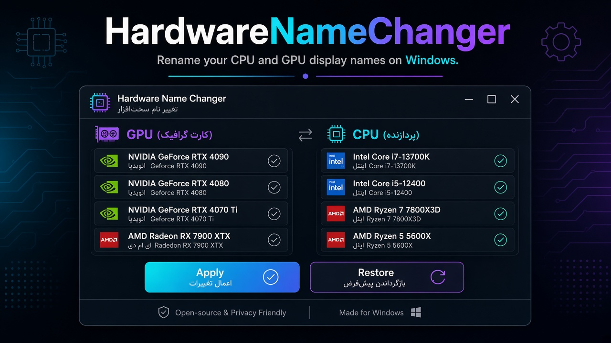
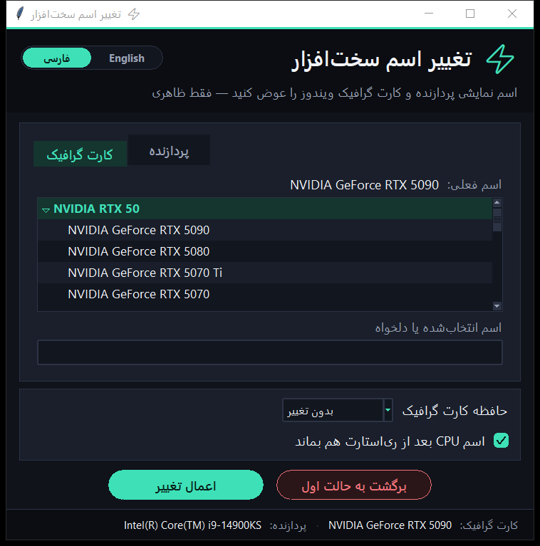
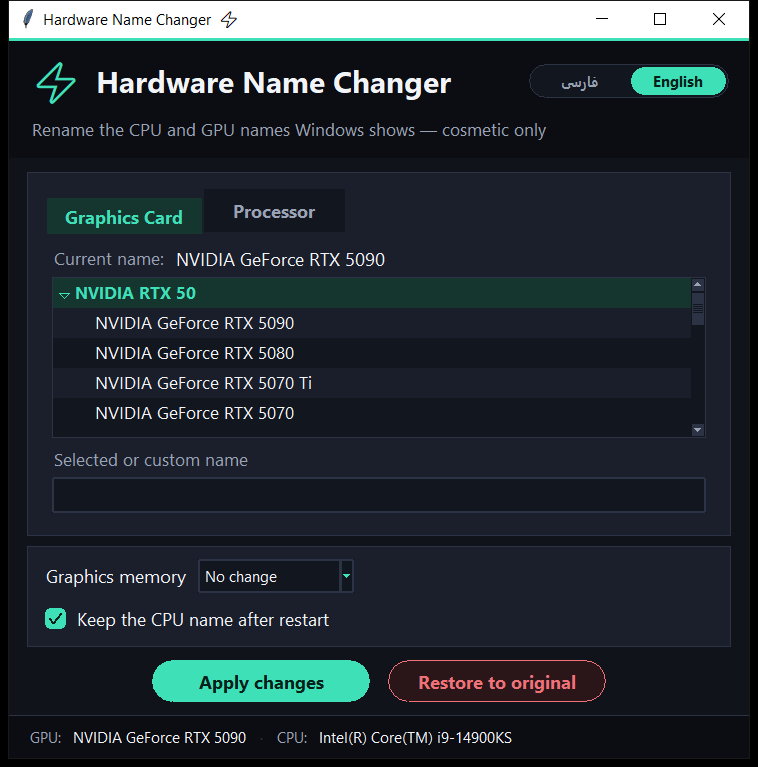
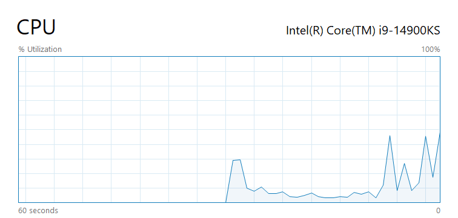
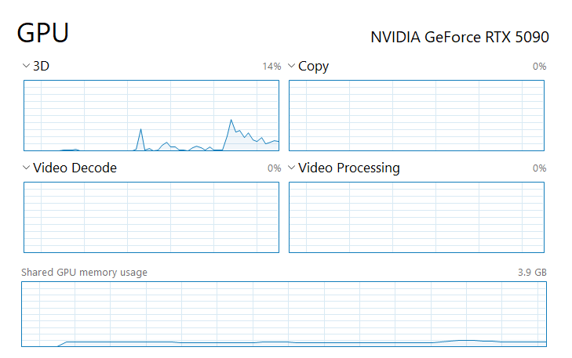

<p align="center">
  
</p>

<h1 align="center">HardwareNameChanger</h1>

<p align="center">
  <b>Rename the CPU & GPU names Windows shows</b> — one click, with presets, backup & restore.<br>
  <b dir="rtl">اسم نمایشی پردازنده و کارت گرافیک ویندوز را با یک کلیک عوض کنید</b> — لیست آماده، بکاپ و بازگشت.
</p>

<p align="center">
  <a href="#english"></a>
  <a href="#persian--فارسی"></a>
  
  
  
  
</p>

<p align="center">
  
  <br>
  
</p>

---

<a id="english"></a>

## English

### Why this exists
Windows shows your CPU and GPU names in **Settings → About**, Task Manager, Device Manager, and many apps.  
**HardwareNameChanger** lets you pick a new *display name* from categorized presets (or type your own), applies it safely with a first-run backup, and can restore the originals anytime.

The app is **bilingual** (Persian / English). It follows the Windows UI language on first run, and you can switch live from the header. Your choice is remembered.

> Cosmetic only. It does **not** upgrade hardware, unlock performance, or change RAM size.

### Features
- **Persian and English UI**, switchable at any time
- **GPU rename** across the places Windows actually reads (driver description, Device Manager name, protected PnP property)
- **CPU rename** with optional **auto re-apply at login** (Windows rebuilds the CPU string on every boot)
- **VRAM label** presets (registry / DirectX reporting — About page may still show the driver dummy value on iGPU)
- Dozens of ready names: RTX 50/40/30, AMD Radeon, Intel Arc, Core Ultra, Ryzen, Threadripper, Xeon, and a fun category
- **Restore to original** from a hidden backup
- Double-click **`build.bat`** to build a single admin-aware `.exe` with PyInstaller

### Result
After Apply, Task Manager shows the new display names (cosmetic only):

<p align="center">
  
  
</p>

### Quick start
1. Download **HardwareNameChanger.exe** from the latest [Release](https://github.com/amirreza-fnt/HardwareNameChanger/releases/latest).
2. Run the exe → allow **Administrator** once → pick a language if you want → pick names → **Apply changes**.
3. Restart once if the GPU name still looks stale in About.

To build from source (Python 3.11+):

```bat
pip install pyinstaller
pyinstaller --onefile --noconsole --uac-admin --name HardwareNameChanger hwname.py
```

Or just double-click **`build.bat`**.

### Restore
Open the app → **Restore to original**.  
Backups live in a hidden folder: `C:\ProgramData\HardwareNameChanger`  
Deleting the `.exe` alone does **not** undo registry changes — use Restore (or keep a copy of the app).

### Safety notes
- Admin rights required
- First apply saves originals for Restore
- Driver updates may overwrite GPU labels — re-apply if needed
- Some antivirus tools dislike registry editors; this project is open source so you can audit `hwname.py`

### Keywords
`windows gpu rename` · `change cpu name windows` · `spoof gpu name` · `device manager rename` · `hardware name changer` · `rtx registry DriverDesc` · `ProcessorNameString`

---

<a id="persian--فارسی"></a>

## فارسی

### این برنامه چیکار می‌کنه؟
ویندوز اسم CPU و GPU رو توی **تنظیمات → درباره**، Task Manager، Device Manager و خیلی برنامه‌ها نشون می‌ده.  
با **HardwareNameChanger** از لیست دسته‌بندی‌شده یه اسم انتخاب می‌کنی (یا خودت می‌نویسی)، با یک کلیک اعمال می‌شه، بکاپ گرفته می‌شه، و هر وقت خواستی برمی‌گرده به حالت اول.

برنامه **دوزبانه** است (فارسی و انگلیسی). بار اول زبان ویندوز را دنبال می‌کند و از نوار بالا می‌توانی همان لحظه عوضش کنی. انتخاب ذخیره می‌شود.

> فقط ظاهریه. سخت‌افزار واقعی، سرعت، یا حجم رم سیستم عوض نمی‌شه.

### امکانات
- رابط **فارسی و انگلیسی** با تعویض آنی زبان
- تغییر اسم **کارت گرافیک** در جاهایی که ویندوز واقعاً می‌خونه
- تغییر اسم **پردازنده** + گزینه ماندگاری بعد از ری‌استارت (چون ویندوز اسم CPU رو با هر روشن شدن از نو می‌سازه)
- انتخاب برچسب **حافظه گرافیک** (بعضی صفحات About روی گرافیک مجتمع ممکنه هنوز عدد ساختگی درایور رو نشون بدن)
- ده‌ها اسم آماده: سری RTX، AMD، Intel Arc، Core Ultra، Ryzen و دسته شوخی
- دکمه **برگشت به حالت اول**
- ساخت exe با دابل‌کلیک روی **`build.bat`**

### نتیجه
بعد از اعمال تغییر، Task Manager اسم‌های جدید را نشان می‌دهد (فقط ظاهری):

<p align="center">
  
  
</p>

### شروع سریع
1. فایل **HardwareNameChanger.exe** را از [Releases](https://github.com/amirreza-fnt/HardwareNameChanger/releases/latest) دانلود کن.
2. exe را باز کن → یک‌بار اجازه Admin بده → در صورت نیاز زبان را عوض کن → اسم‌ها را انتخاب کن → **اعمال تغییر**.
3. اگر About هنوز اسم قدیمی GPU را نشان می‌داد، یک‌بار Restart کن.

برای ساخت از روی منبع، پایتون ۳.۱۱+ لازم است؛ یا روی **`build.bat`** دابل‌کلیک کن.

### بازگشت
دکمه **برگشت به حالت اول** را بزن.  
بکاپ‌ها توی پوشه مخفی `C:\ProgramData\HardwareNameChanger` هستن.  
فقط پاک کردن exe تغییرات رجیستری را برنمی‌گردونه.

### نکات ایمنی
- نیاز به دسترسی Administrator
- اولین اعمال، اسم‌های اصلی را ذخیره می‌کند
- آپدیت درایور ممکن است اسم GPU را برگرداند
- کد منبع باز است؛ قبل از اجرا می‌توانی `hwname.py` را بخوانی

### کلمات کلیدی
`تغییر اسم کارت گرافیک` · `تغییر اسم پردازنده ویندوز` · `عوض کردن نام GPU` · `Device Manager` · `رجیستری ویندوز`

---

## Project layout

```
HardwareNameChanger/
├── hwname.py          # main app (Python + tkinter)
├── build.bat          # one-click PyInstaller build
├── LICENSE
├── README.md
└── docs/images/       # banner & screenshots
```

## Contributing
PRs welcome: more presets, better About coverage, translations, UI polish.

## Disclaimer
For personal / educational / fun use. Do not use to misrepresent hardware in sales, warranties, or benchmarks. You are responsible for how you use this tool.

## License
[MIT](LICENSE) © 2026 [amirreza-fnt](https://github.com/amirreza-fnt)
